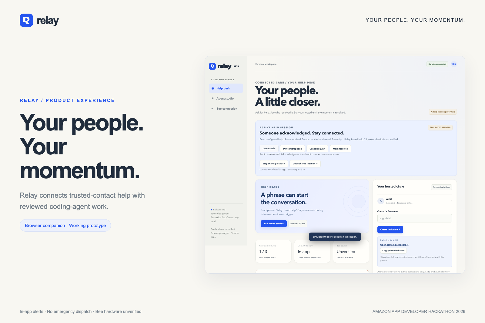
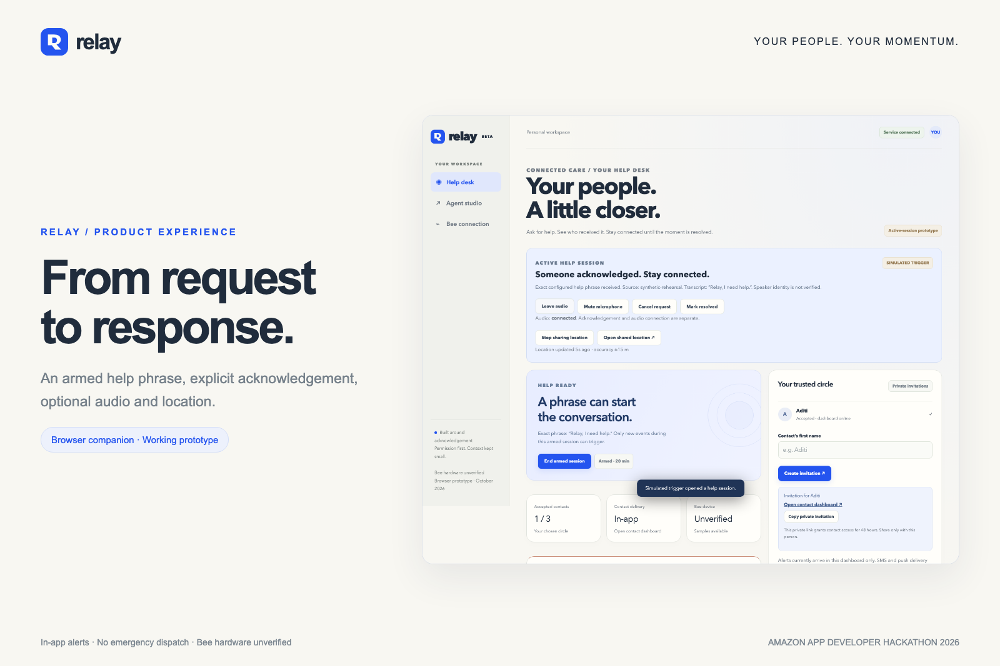
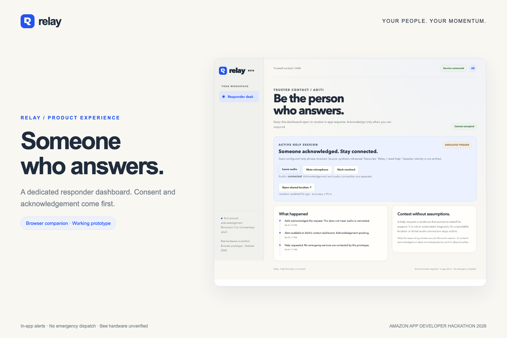
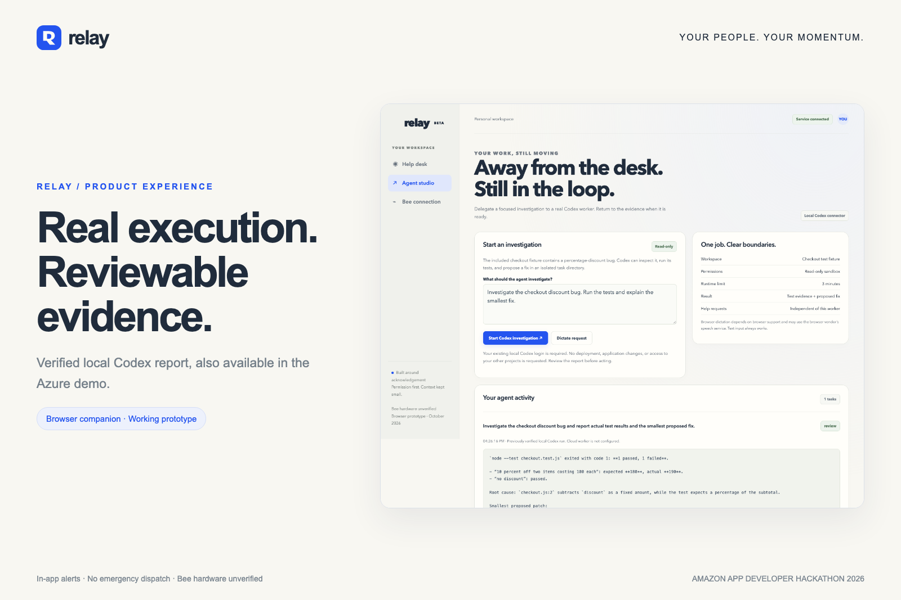
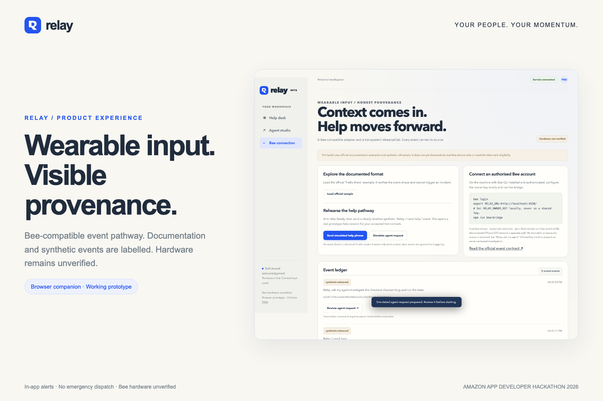
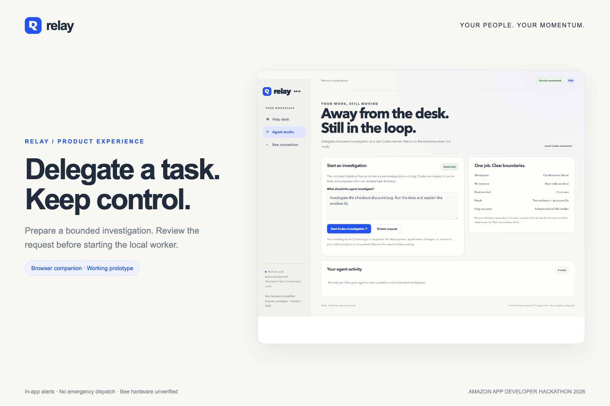
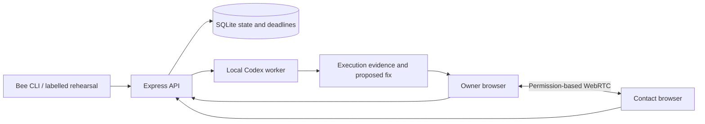

<div align="center">


# Relay

**Live at:** https://relay-cb7fb9.koreacentral.cloudapp.azure.com/relay/

### Your people. Your momentum.

A browser companion for trusted-contact help and reviewed coding-agent work.

[**Launch Azure demo ↗**](https://relay-cb7fb9.koreacentral.cloudapp.azure.com/relay/) · [**Narrated video**](docs/media/relay-narrated-demo.mp4) · [**Reviewer walkthrough**](#review-in-five-minutes) · [**Run locally**](#run-locally)


</div>



## Why Relay exists

Sending an alert is only the beginning. Has anyone acknowledged it? Can they connect? Do they have useful context? Has the request actually been resolved?

Relay makes that response visible. It also explores ordinary wearable assistance: prepare a coding task while away from your desk, review it, and inspect the evidence from a real agent run.

**Current scope:** a working browser companion. Bee input follows the documented event contract; physical-device validation and genuine device data remain outstanding. Alerts are in-app only. Relay does not contact emergency services.

## Two workflows, one companion

| Trusted-contact help | Reviewed agent work |
|---|---|
| Invite up to three contacts; each explicitly accepts | Prepare requests using text or supported browser dictation |
| Request help by button, an armed exact phrase, or a missed check-in | Bee-compatible agent utterances become reviewable drafts |
| Escalate after 30 seconds without acknowledgement | Run an authenticated local Codex investigation |
| Join WebRTC audio with permission on both sides | Inspect actual command output and a proposed patch |
| Share location with visible age and accuracy | Read-only fixture, one job at a time, three-minute limit |
| Cancel or resolve, clearing location and audio signaling | No automatic changes, commits or deployments |

## Review in five minutes

### 1. Enter the Azure demo

Open **[Relay on Azure](https://relay-cb7fb9.koreacentral.cloudapp.azure.com/relay/)** and click **Open my workspace**.

**No username, password, API key or special link is required.** This is a shared judging workspace with intentionally public owner access. Use fictional names and test data only. Private/local deployments keep `RELAY_PUBLIC_DEMO` disabled.

### 2. Complete the help loop

1. In **Help desk**, create a contact invitation with a fictional name.
2. Open its link in another browser profile or incognito window, accept, and keep that dashboard open. One reviewer may play both roles; headphones prevent feedback.
3. In the owner workspace, arm a session. In **Bee connection**, load the official sample: it must not trigger a help request.
4. Click **Send simulated help phrase**. The source is explicitly synthetic.
5. In the contact browser, click **I can help · acknowledge**.
6. Enable live audio separately on both sides and grant microphone permission. Acknowledgement and connection are shown separately.
7. Optionally share browser location; inspect age and accuracy. Cancel or resolve: location is removed and the audio workflow ends.

Alerts arrive in accepted contacts' **open dashboards**. SMS, push notifications and calls are not configured. Restrictive networks may require TURN for audio. If the shared demo's three contact slots are occupied, run locally for an independent fresh workspace.

### 3. Inspect real agent evidence

Open **Agent studio** in the hosted demo. A preserved report comes from a **verified local Codex run**: the checkout fixture returned **190 instead of 180**. Codex ran the tests, identified fixed subtraction instead of a percentage discount, and proposed a patch. One test passed and one intentionally failed. The patch was not applied.

**New investigations run locally.** The cloud service disables new jobs because it does not contain personal Codex credentials. Reproduce the investigation with your own authenticated Codex CLI below.

### 4. Inspect the wearable pathway

In **Bee connection**, compare documentation samples with synthetic events. Click **Simulate agent request**, then **Review agent request**: the draft appears in Agent studio without starting execution automatically. A CLI-route label identifies ingestion, not hardware attestation or speaker identity.

## Screenshots

| Help desk | Trusted contact |
|---|---|
|  |  |

| Real Codex evidence | Bee-compatible input |
|---|---|
|  |  |



## Demo videos and production sources

- **[Narrated walkthrough: 2:15, 1920×1080](docs/media/relay-narrated-demo.mp4)**: synthetic Kokoro narration with lowered instrumental music.
- [Music-only edit: 2:15, 1920×1080](docs/media/relay-judges-demo.mp4).
- [Poster](docs/media/relay-video-poster.jpg), [editable Hyperframes composition](production/video/composition), [narration script and WAV files](production/video/voice), and [storyboard](production/video/brag-plan.md).

Both MP4s are committed directly. GitHub may offer them as downloads; download and open locally if inline playback is unavailable. To re-render the visual composition:

```sh
npx --yes hyperframes@0.8.186 check production/video/composition
npx --yes hyperframes@0.8.186 render production/video/composition --output relay-visual-edit.mp4 --fps 24
```

## Run locally

Requires **Node 22.13+**, npm, and a modern Chromium-based browser. The container and CI use Node 24.

```sh
git clone https://github.com/adipatel399/Relay.git
cd Relay
npm ci
npm start
```

Open **http://127.0.0.1:4320** and click **Open my workspace**. Default local entry is limited to the host computer. On macOS, `node scripts/open-link.js` also opens your generated private owner link.

No credentials are needed for a local help rehearsal. The server creates `.relay/owner-key` and `.relay/relay.sqlite`; these are excluded from Git. Contact invitations expire after 48 hours. Keep them private outside the shared judging demo.

### Run the actual coding agent

Install and sign into Codex CLI with your own account. Ensure `codex` is on PATH, or export `RELAY_CODEX_BIN` pointing to its executable. Open Agent studio and start the checkout investigation.

The connector uses `codex exec --ignore-user-config --ephemeral --sandbox read-only --json` and a dedicated fixture directory. This version supports Codex and the included checkout fixture, not arbitrary projects or every coding provider. Cancelled, failed, timed-out and interrupted jobs remain distinct. No patch is automatically applied.

Browser dictation is optional and may use the browser vendor's speech service. Text entry always works.

## Run the tests

```sh
npm ci
npm test
npx playwright install chromium
npm run test:ui
```

The browser suite starts a temporary server and cleans up its own state. Two separate browser contexts use synthetic microphones and mocked Mumbai geolocation. These tests exercise actual WebRTC transport; they do not establish physical microphone quality or background mobile reliability.

| Verification | Recorded outcome |
|---|---|
| Engine, API and worker tests | 12 passing |
| Browser scenarios | 8 passing |
| Real Codex execution | Actual test output and proposed fix captured separately from unit-test doubles |
| Azure browser review | Fresh-browser entry and saved report verified; zero runtime errors |
| Narrated video | 135 seconds, H.264/AAC, 1920×1080 |

[Captured evidence](docs/evidence) · [Verification details](docs/VERIFICATION.md). Reruns write generated reports/screenshots to ignored `artifacts/`.

## Connect an authorised Bee account

With the official Bee CLI installed and an authorised account:

```sh
bee login
export RELAY_URL=http://127.0.0.1:4320/
export RELAY_OWNER_KEY="$(cat .relay/owner-key)"
npm run bee:bridge
```

The adapter consumes `bee stream --types new-utterance --json`. It is **companion software, not Bee firmware**. Receipt timestamps cannot establish original audio capture time when upstream events are delayed.

No physical Bee has been tested. No heart-rate, blood-pressure, sweat, wearable speaker API, raw background audio or automatic attack detection is assumed. **Bee-track eligibility requires real Bee or Apple Watch data; this simulated demo does not establish eligibility.** See [sources and provenance](docs/SOURCES.md).

## Architecture



One owner has one active help session. Check-in deadlines and bounded histories persist across restart. Restart clears ephemeral audio signaling; interrupted coding tasks are not silently rerun. Contact access is scoped and expiring, with contact credentials hashed at rest.

[Architecture and phases](docs/ARCHITECTURE.md) · [Security and failure behaviour](docs/SECURITY.md) · [Demo script](docs/DEMO_SCRIPT.md).

## Configuration and deployment

Use `.env.example` as a template. `npm start` does not load `.env` automatically: export variables or use `node --env-file=.env server/index.js`.

| Variable | Purpose |
|---|---|
| `RELAY_PORT` | Default 4320 |
| `RELAY_HOST` | Default 127.0.0.1; use 0.0.0.0 only behind an HTTPS proxy |
| `RELAY_CODEX_BIN` | Optional local Codex executable |
| `RELAY_AGENT_DISABLED=1` | Disable jobs on hosts without a coding worker |
| `RELAY_PUBLIC_DEMO=1` | Intentionally allow public shared-owner demo entry; use synthetic data only |
| `RELAY_TURN_URL`, `RELAY_TURN_USER`, `RELAY_TURN_PASSWORD` | Optional TURN relay; supply all three |

The Dockerfile runs as a non-root user. Persist `/app/.relay` on a private volume, serve remote access over HTTPS, and use a single app process. The supplied image does not contain authenticated Codex credentials. Read-only sandboxing is not complete host confidentiality isolation; review the security notes before supporting untrusted multi-user requests.

This repository excludes live databases, owner keys, Azure account state, deployment passwords, node_modules and render caches. No shared Azure or Codex credentials are needed or provided.

## Next milestones

Validate with authorised real device data; measure transcript latency and disconnect behaviour; improve external notification delivery and TURN coverage; test with actual users; and expand agent workspaces with explicit permissions and stronger execution isolation.

## Credits

Music: **Phonk Execution: Alex-Productions**, [onsound.eu](https://www.onsound.eu/) / [free-stock-music.com](https://www.free-stock-music.com/), [CC BY 3.0](https://creativecommons.org/licenses/by/3.0/); edited instrumental mix. Narration: synthetic Kokoro `af_heart`. Inter and Anton fonts use the SIL Open Font License; notices are bundled with the production assets.

Built by **Aditya Patel** for the Amazon App Developer Hackathon 2026. Browser prototype; hardware integration remains unverified.

## License

Original project source is available under the [MIT License](LICENSE). Third-party dependencies, fonts and music retain their respective licenses; see the credits and bundled notices.
